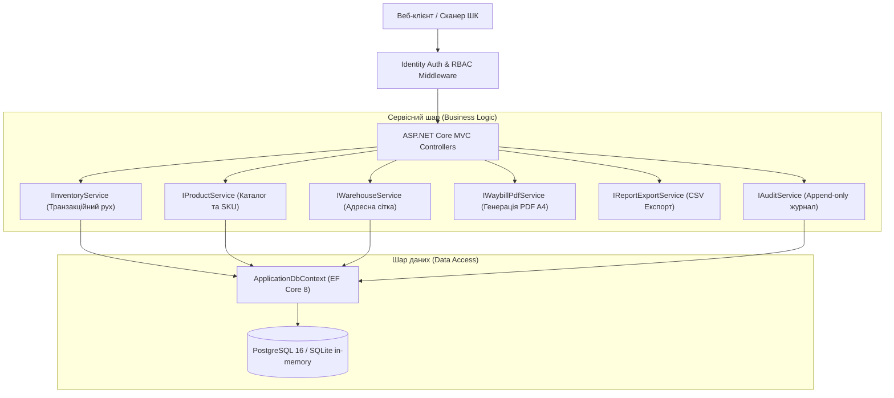
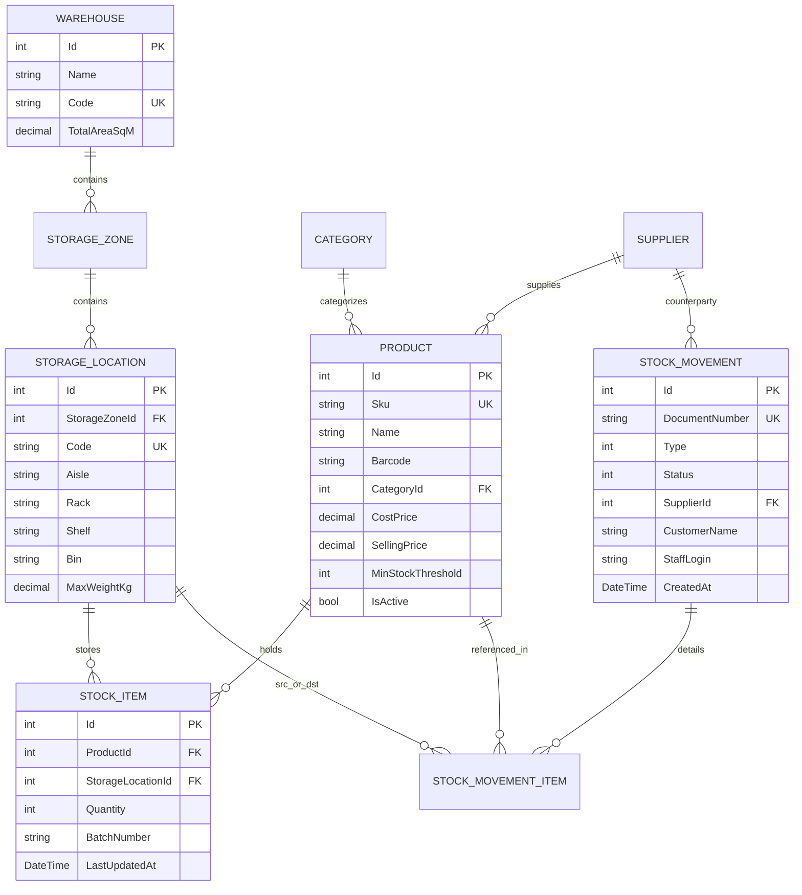

# WarehouseReserveSystem (WMS) — Enterprise Addressable Inventory Management

[](https://dotnet.microsoft.com/)
[](https://github.com/NoobITafk/WarehouseReserveSystem/actions/workflows/ci.yml)
[](https://learn.microsoft.com/en-us/dotnet/csharp/)
[](https://www.postgresql.org/)
[](https://www.docker.com/)
[](https://xunit.net/)
[](https://warehousereserve.duckdns.org)
[](LICENSE)

Сучасна, повнофункціональна система адресного складського обліку та управління запасами (**WMS — Warehouse Management System**) промислового рівня на стеку **ASP.NET Core 8 (.NET 8 LTS)** та **Entity Framework Core 8**.

---

## 🌐 Живий продакшн (Live Demo)

Система розгорнута на виділеному сервері під керуванням Nginx Reverse Proxy з автоматичним SSL (Let's Encrypt):

🔗 **[https://warehousereserve.duckdns.org](https://warehousereserve.duckdns.org)**

### Демо-доступи:

| Роль | Логін | Пароль | Сфера відповідальності |
| :--- | :--- | :--- | :--- |
| **Admin** | `admin` | `Admin#2026!WMS` | Повний доступ до всіх складів, товарів, персоналу та аудиту |
| **Storekeeper** | `storekeeper` | `Storekeeper#2026!WMS` | Оприбуткування, відвантаження, внутрішнє переміщення, генерація накладних |
| **Auditor** | `auditor` | `Auditor#2026!WMS` | Звіти, експорт залишків у CSV, журнал незмінного аудиту |

---

## 🌟 Ключові можливості

- **📍 Адресне зберігання (Coordinate Cell Storage):**
  - Ієрархія: Склад $\rightarrow$ Зона зберігання $\rightarrow$ Комірка (Ряд - Стелаж - Полиця - Осередок, наприклад `A-01-02-B`).
  - Контроль максимальної ваги (кг) та об'єму ($м^3$) для кожної комірки.
- **📦 Каталог номенклатури (SKU & Barcode):**
  - Унікальні артикули (SKU) та EAN-13 штрих-коди.
  - Категорії, постачальники, одиниці виміру, собівартість та ціна реалізації.
  - Контроль мінімального критичного порогу залишків (`MinStockThreshold`).
- **🔄 Атомарні складські операції (ACID Transactions):**
  - **Оприбуткування (Receipt):** прийом партій від постачальників у конкретні комірки.
  - **Відвантаження (Shipment):** суворий контроль наявності (захист від від'ємних залишків та оверселінгу).
  - **Внутрішнє переміщення (Transfer):** атомарне перенесення між комірками в єдиній DB-транзакції.
  - **Списання (Write-Off):** брак, пошкодження, сплив терміну придатності.
- **📄 Первинні документи та PDF-генерація:**
  - Генерація офіційних друкованих накладних А4 (прибуткових / видаткових) через `PdfSharpCore`.
  - Повні реквізити, таблична частина, підсумкові суми та місця для підписів.
- **📊 Аналітика та експорт:**
  - Інтерактивний дашборд: загальна фінансова оцінка залишків, метрики зайнятості, швидкі сповіщення.
  - Експорт складського балансу та реєстру операцій у **CSV з UTF-8 BOM** для прямого імпорту в Excel.
- **🔒 Безпека та Аудит (Security & Compliance):**
  - ASP.NET Core Identity з Cookie-автентифікацією.
  - Рольова модель доступу (RBAC): `Admin`, `Storekeeper`, `Auditor`.
  - Повний незмінний аудит-трейл (`AuditLogs`) з фіксацією користувача, IP-адреси, часу та типу дії.

---

## 🏛️ Архітектура системи



---

## 🗄️ Схема бази даних (ER Diagram)



---

## 🚀 Швидкий запуск

### 1. Локальний запуск (Development)

Потрібен встановлений [.NET 8 SDK](https://dotnet.microsoft.com/download/dotnet/8.0).

```bash
# Клонувати репозиторій або перейти в теку проєкту
cd C:\Project\WarehouseReserveSystem\WarehouseReserveSystem

# Запустити застосунок (БД SQLite створиться і наповниться початковими демо-даними автоматично)
dotnet run
```

Після запуску відкрийте браузер за адресою: **`http://localhost:5000`**

### 2. Запуск у Docker Compose (Production Ready)

Для повноцінного запуску веб-додатку разом із промисловою базою даних **PostgreSQL 16**:

```bash
cd C:\Project\WarehouseReserveSystem

# Підняти контейнери у фоновому режимі
docker-compose up -d --build
```

Додаток буде доступний за адресою: **`http://localhost:8090`** (або на IP VPS `http://152.70.19.219:8090`)

---

## 🧪 Запуск автоматичних тестів

Система покрита повним набором xUnit-тестів з використанням ізольованого SQLite in-memory сховища (що гарантує перевірку справжніх SQL-транзакцій та обмежень зовнішніх ключів):

```bash
cd C:\Project\WarehouseReserveSystem
dotnet test
```

Результат:
```
Passed! - Failed: 0, Passed: 12, Skipped: 0, Total: 12, Duration: 1 s
```

---

## 👥 Облікові записи та ролі для тестування

В системі реалізовано безпечний **Швидкий демо-вхід (1 клік)** без необхідності вручну вводити облікові дані, або через змінні оточення:

| Роль | Призначення | Доступні модулі та права |
| :--- | :--- | :--- |
| **Admin** (Олександр Керівник) | Повний доступ | Товари, склади, персонал, переміщення, повний системний аудит |
| **Storekeeper** (Василь Комірник) | Операційний склад | Оприбуткування, відвантаження, внутрішнє переміщення, друк PDF-накладних |
| **Auditor** (Олена Аудитор) | Контроль та аудит | Звіти, експорт CSV-залишків, перегляд накладних, незмінний журнал аудиту |

---

## 📑 Структура проєкту

```
WarehouseReserveSystem/
├── WarehouseReserveSystem/             # Основний веб-застосунок (ASP.NET Core 8 MVC)
│   ├── Controllers/                    # Контролери (Products, Stock, Movements, Warehouses, Reports, Audit)
│   ├── Data/                           # ApplicationDbContext, конфігурація зв'язків та SeedData
│   ├── Models/                         # Доменні сутності (Product, StockItem, StockMovement, StorageLocation...)
│   ├── Services/                       # Бізнес-логіка (Inventory, WaybillPdf, Export, Warehouse, Audit)
│   ├── ViewModels/                     # Моделі представлення та форми введення
│   ├── Views/                          # Оптимізовані Razor-шаблони в сучасному темному UI
│   ├── wwwroot/                        # Статичні ресурси, CSS-стилі (site.css), фавікони
│   └── Program.cs                      # Точка входу, DI-контейнер, налаштування Cookie Auth & Identity
├── WarehouseReserveSystem.Tests/       # Проєкт автоматизованого тестування (xUnit + SQLite in-memory)
│   ├── InventoryServiceTests.cs        # Тести приходу, відвантаження, переміщень, контролю дефіциту
│   ├── ProductServiceTests.cs          # Тести унікальності SKU та безпечного Soft Delete
│   ├── WarehouseServiceTests.cs        # Тести адресної сітки та локацій
│   ├── ReportExportServiceTests.cs     # Тести формування CSV-звітів
│   └── WaybillPdfServiceTests.cs       # Тести генерації PDF-накладних
├── Dockerfile                          # Багатоетапна збірка контейнера з fontconfig для PDF
├── docker-compose.yml                  # Оркестрація веб-застосунку та PostgreSQL 16
├── DEFENSE_CHECKLIST.md                # Шпаргалка для захисту курсової / технічної співбесіди
└── README.md                           # Головна документація проєкту
```

---

## 📄 Ліцензія

Проєкт розповсюджується під ліцензією [MIT](LICENSE).
